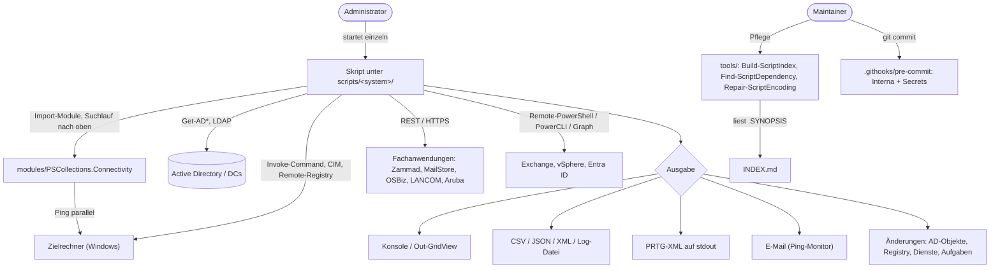

# Architektur-Übersicht – PowerShellCollections

Eine gewachsene, öffentliche Sammlung von 146 PowerShell-Skripten aus dem Windows-/AD-Betrieb: Ein Administrator
startet einzelne Skripte von seinem Verwaltungs-PC aus; sie fragen Active Directory, Windows-Rechner,
Netzwerkgeräte und Fachanwendungen ab oder ändern sie. Es gibt kein gemeinsames Hauptprogramm — die Architektur ist
die Ablageordnung (`docs/STRUCTURE.md`) plus drei Pflegewerkzeuge unter `tools/`.

---

## Stack

| Schicht | Technologie |
|---------|-------------|
| Skripte | Windows PowerShell 5.1 und PowerShell 7.x (je Skript; `#Requires` wo gesetzt) |
| Gemeinsamer Code | Modul `modules/PSCollections.Connectivity` (PS 5.1+); fachliche Module bei ihrer Domäne (`OSBiz.psm1`, `PRTG.Dsls.psm1`, `Win10PingMonitor.psm1`) |
| Zielsysteme | Active Directory/LDAP, Windows-Rechner (WinRM, CIM, Remote-Registry, Eventlog), Exchange, VMware vSphere, Netzwerkgeräte (LANCOM, Aruba), Fachanwendungen per REST (Zammad, MailStore, OpenScape Business) |
| Datenbank | keine eigene; zwei Skripte prüfen fremde SQL-Server-/OLE-DB-Verbindungen |
| Auth | Kerberos/Windows-integriert im Kontext des angemeldeten Admins; für REST-APIs interaktiv per `Get-Credential`/`SecureString` (`security/AUTHENTICATION.md`) |
| Build | keiner — Skripte laufen aus dem Arbeitsverzeichnis; `tools/Build-ScriptIndex.ps1` erzeugt `INDEX.md` |
| Repo-Schutz | `.githooks/pre-commit` (Interna und Secrets), `.gitattributes` (Zeilenenden/Encoding) |

---

## Scope-Grenzen — Was dieses System NICHT tut

Bewusste Negativ-Liste. Sie verhindert Scope Creep und macht
Architekturentscheidungen nachvollziehbar.

- Kein Produkt und kein Modul zur Veröffentlichung (PSGallery): Skripte werden einzeln gelesen, angepasst und
  gestartet; es gibt keine Release-Versionen.
- Keine zentrale Konfiguration und keine Ablage von Zugangsdaten im Repo — Werte kommen als Parameter oder
  interaktiv.
- Keine Gewähr für Lauffähigkeit: Qualität und Aktualität schwanken (`README.md` „Zustand der Skripte"); vor dem
  Produktiveinsatz lesen und in einer Testumgebung ausprobieren.
- Kein Ort für Fremdcode-Weiterentwicklung: `third-party/` bleibt unverändert.
- Keine firmenspezifischen Daten: Beispiele nutzen Platzhalterwerte (`docs/CONVENTIONS.md` §11); interne
  Umgebungsangaben nur in `docs/local/` (gitignored).
- Ausgelagerte Projekte (Firebird-Trace-Parser, Firebird→MSSQL-Sync) liegen in eigenen Repositories; hier steht nur
  noch je ein README mit Verweis.

Änderungen an dieser Liste sind eine Architekturentscheidung → ADR erforderlich.

---

## Systemstruktur (Datenfluss)



Zwei Skripte laufen nicht auf dem Verwaltungs-PC, sondern auf dem Zielrechner: `Invoke-SecureBootCertUpdate.ps1`
wird laut seiner README als Text eingelesen und dort als Scriptblock erzeugt, `Enable-ShadowCopy.ps1` läuft
direkt auf dem Zielsystem. Dort gibt es kein `modules/` (`docs/BACKLOG.md` Abschnitt 4,
`architecture/REMOTE_EXECUTION.md`).

---

## Modul-Verantwortlichkeiten

```
scripts/active-directory/  → AD-Objekte, GPO, DNS, LDAP, Anmelde-Events, Zeitsync abfragen und pflegen
scripts/windows/           → Betriebssystem auf einem oder vielen Rechnern: Sessions, Prozesse, Dienste, Tasks, WMI, Eventlog
scripts/security/          → Zertifikate, Secure Boot, BitLocker, Passwortprüfung, EDR-Verteilung, log4j-Suche
scripts/network/           → Netzwerkgeräte und -dienste: LANCOM, Aruba, DHCP, Firewall, WOL, Diagnose
scripts/monitoring/        → Überwachung: PRTG-Sensoren, Ping-Monitor, Web-Änderungen
scripts/messaging/         → Exchange, Outlook, MailStore, NoSpamProxy
scripts/databases/         → SQL-Server-Versionen und DB-Verbindungstest (Firebird-Projekte ausgelagert)
scripts/applications/      → Fachanwendungen: DocuWare, Zammad, TeamViewer, Kyocera, FileZilla, OpenScape, Excel, Teams
scripts/filesystem/        → Berechtigungen, Suche, Links, Archivierung
scripts/virtualization/    → VMware vSphere
modules/                   → Funktionen, die mehrere Fachdomänen brauchen (heute nur PSCollections.Connectivity)
snippets/                  → Code-Beispiele ohne Betriebszweck
third-party/               → fremder, unveränderter Code mit ORIGIN.md
tools/                     → Werkzeuge für das Repo selbst (Index, Abhängigkeiten, Encoding)
_inbox/                    → befristete Zwischenablage (30-Tage-Regel)
.githooks/                 → pre-commit gegen Interna und Secrets
```

---

## Entscheidungsrelevante Constraints

| Constraint | Auswirkung |
|-----------|-----------|
| Repository ist öffentlich | Keine Interna in Code, Doku, Commit-Messages; Pre-commit-Hook; interne Angaben nur in `docs/local/` |
| Skripte laufen unter Windows PowerShell 5.1 **und** PowerShell 7 | UTF-8-BOM-Pflicht bei Umlauten; keine PS7-only-Syntax in Dateien ohne `#Requires -Version 7` |
| Skripte sind eigenständig und werden einzeln kopiert/gestartet | Gemeinsamer Code nur unter hoher Hürde (`modules/`, Drei-Domänen-Regel); Modulimport über Suchlauf nach oben |
| Teile laufen als Scriptblock auf Zielrechnern | Dort keine Abhängigkeit auf `modules/` oder Dateien des Repos (`docs/BACKLOG.md` Abschnitt 4) |
| Die meisten Skripte führen beim Laden Code aus | Erkunden durch Lesen, nicht Dot-Sourcing; Tests nur mit Mocks |
| Ein Autor, keine CI | Qualitätssicherung über lokale Werkzeuge (`tools/`, PSScriptAnalyzer, künftig Pester) |

---

## Lese-Pfad für Architektur-Details

Wenn du tiefer einsteigen willst, lies in dieser Reihenfolge — jeder Schritt
baut auf dem vorigen auf:

1. **Diese Datei** (`OVERVIEW.md`) — Big Picture, Scope-Grenzen, Datenfluss.
2. `docs/STRUCTURE.md` — **Bestand:** Ablageregel, Verzeichnisbaum, Module, Namenskonventionen (maßgeblich für
   „wohin gehört eine Datei?"; zwei Abschnitte veraltet, `KNOWN_ISSUES.md` K7).
3. `architecture/PROJECT_LAYOUT.md` — Abhängigkeitsregeln zwischen Skripten, Modulen und Werkzeugen.
4. `architecture/CONFIGURATION.md` — wie Skripte ihre Werte bekommen (Parameter, keine Konfigurationsdateien).
5. `architecture/ERROR_HANDLING.md` — wie Fehler propagiert und behandelt werden.
6. `architecture/ADR/` — historische Architekturentscheidungen (noch keine; Bestandsentscheidungen stehen in
   `docs/STRUCTURE.md` und `docs/BACKLOG.md`).
7. **Stack-spezifische Architektur-Docs:** `architecture/REMOTE_EXECUTION.md` (WinRM/CIM),
   `architecture/CREDENTIAL_STRATEGY.md`, `architecture/DEPENDENCIES.md`.
8. **Bestand, Entscheidungen und offene Punkte:** `docs/BACKLOG.md` (Bestandsabschnitte 1–9),
   `docs/HISTORY-OPTIONS.md` (Entscheidungsvorlage zur History-Bereinigung).
9. **Skript-Übersicht:** `INDEX.md` (generiert) und die READMEs der Themenordner, z. B.
   `scripts/monitoring/prtg/README.md` (Referenz für den Zuschnitt eines Themas),
   `scripts/security/certificates/ARCHITECTURE.md`, `scripts/security/secure-boot/README.md`.

Begriffe und Geschäftssprache: `docs/GLOSSARY.md`.
Bekannte Einschränkungen und Probleme: `docs/KNOWN_ISSUES.md`.
