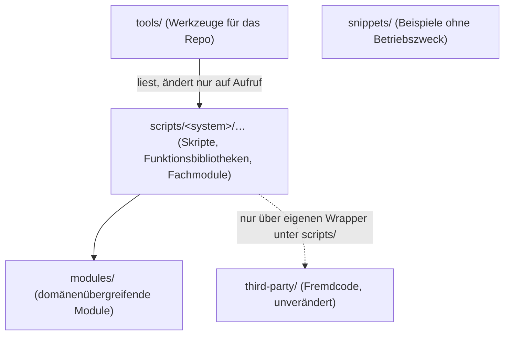

# Projekt-Layout – PowerShellCollections

Ordnerstruktur und Abhängigkeitsregeln. Die **Ablageregel** („ein Skript liegt unter dem System, gegen das es
läuft"), der vollständige Verzeichnisbaum und die Herleitung stehen im Bestandsdokument `docs/STRUCTURE.md` —
diese Datei wiederholt sie nicht, sondern ergänzt die Abhängigkeitsrichtung und den ausführbaren Check.

Verbindet sich mit den Prinzipien [[SEPARATION_OF_CONCERNS]] und [[ORTHOGONALITY]].

> Das sprach-agnostische Schichtenmodell des Templates (Präsentation → Anwendung → Domäne → Infrastruktur,
> `src/`/`tests/`-Skelett) passt auf eine Sammlung eigenständiger Skripte nicht und ist hier gestrichen. Die
> „Schichten" dieses Projekts sind die Ablageebenen unten.

---

## Ablageebenen und erlaubte Abhängigkeiten



**Regeln für Abhängigkeiten:**

- Ein Skript nutzt Code aus **seinem eigenen Themenordner** (Funktionsbibliothek, Fachmodul) oder aus `modules/`.
  Aufrufe in einen anderen Themenordner unter `scripts/` sind nicht erlaubt — wird dieselbe Funktion in drei
  Fachdomänen gebraucht, wandert sie nach `modules/` (Drei-Domänen-Regel, `docs/STRUCTURE.md`).
- `modules/` hängt von nichts unter `scripts/` ab.
- `third-party/` wird nicht verändert und nicht direkt aus Betriebsskripten importiert; Ergänzungen kommen als
  Wrapper nach `scripts/` (Beispiel: `scripts/security/secure-boot/`).
- `tools/` liest den ganzen Baum, verändert aber nur auf ausdrücklichen Aufruf (`Repair-ScriptEncoding` ohne
  `-WhatIf`, `Build-ScriptIndex` schreibt `INDEX.md`).
- `snippets/` ist Lesestoff; nichts hängt davon ab.
- **Ausnahme Zielrechner:** Code, der per Scriptblock auf einem Zielrechner läuft, darf **keine** Datei des Repos
  voraussetzen (kein `modules/`, kein `$PSScriptRoot`).

---

## Dateien je Themenordner

```
scripts/<system>/<thema>/
├── Verb-Noun.ps1              # ausführbares Skript, Comment-Based Help mit .SYNOPSIS
├── <Inhalt>Functions.ps1      # optional: Funktionsbibliothek (nur Definitionen, dot-gesourct)
├── <Name>.psm1 / .psd1        # optional: Fachmodul, wenn nur diese Domäne es braucht
├── README.md                  # optional: Zuschnitt, Ausrollen, Vertrag (Referenz: scripts/monitoring/prtg/)
└── .gitignore                 # optional: lokale Ausgaben/Konfiguration des Themas
```

Referenzbeispiel für den Zuschnitt eines Themas: `scripts/monitoring/prtg/` (README mit Ausgabevertrag, Sensoren
importieren ihr Fachmodul relativ über `$PSScriptRoot`).

Tests (ab `TODO.md` I4) liegen unter `tests/` und spiegeln den Pfad des getesteten Codes
(`tests/modules/PSCollections.Connectivity.Tests.ps1`), siehe `testing/UNIT_TESTS.md`.

---

## Regeln

- **Ein Skript je Aufgabe**, keine Versionssuffixe; bewusste Ausnahmen mit Begründung in `docs/BACKLOG.md`.
- **Benennung nach Verantwortung** (Verb-Noun), Bibliotheken nach Inhalt (`docs/CONVENTIONS.md` §12).
- **Imports nur in erlaubter Richtung** (oben); Modulimport aus `modules/` nur über den Suchlauf nach oben.
- **Build-Output und lokale Ausgaben** (`*.log`, CSV-Exporte, lokale Konfiguration) gehören in `.gitignore` — je
  Thema in einer eigenen `.gitignore` des Themenordners, global in der Root-`.gitignore`.

---

## Abhängigkeitsregel als ausführbarer Check

Der Check existiert bereits als Werkzeug: `tools/Find-ScriptDependency.ps1` findet Funktionsaufrufe über
Dateigrenzen und trennt ungedeckte Aufrufe von solchen, die per `Import-Module` aufgelöst sind.

```powershell
.\tools\Find-ScriptDependency.ps1 -CrossFolderOnly   # Soll: ungedeckt: 0
```

- **Heute:** manueller Lauf vor jedem Verschieben, Umbenennen oder Löschen (`docs/CONVENTIONS.md` §10);
  Nachweis der letzten großen Umstellung in `docs/BACKLOG.md` Abschnitt 7.
- **Lücke gegenüber dem Template:** Der Check ist noch kein Teil eines Gate-Laufs und hat keine eigenen Tests
  (erlaubte/verbotene Beispielkante). Die Aufnahme in Gate 4 als Pester-Test steht in `docs/BACKLOG.md`
  („Ideen / Features") und setzt das Test-Fundament aus `TODO.md` I4 voraus.
- Die Regel „kein Aufruf in einen fremden Themenordner" prüft das Werkzeug nur indirekt (`-CrossFolderOnly`
  meldet jeden ordnerübergreifenden Aufruf).

---

## Anti-Pattern

- **Funktion in einen vierten Ordner kopieren**, statt sie nach `modules/` zu ziehen (so entstand die Vorgeschichte
  von `PSCollections.Connectivity`, `docs/BACKLOG.md` Abschnitt 3).
- **Modulimport mit festem relativem Pfad** (`..\..\modules\…`) — bricht beim Verschieben.
- **Restekiste statt `_inbox/`**: ein Ordner ohne Frist für „passt nirgends hin".
- **Änderungen in `third-party/`** statt eines Wrappers.

---

## Pflege

Trigger (siehe `KICKOFF.md` Phase 3a): neuer Ablageort / neues Modul unter `modules/` / Verschiebung zwischen
Themenordnern → diese Datei und `docs/STRUCTURE.md` prüfen; `INDEX.md` neu erzeugen.
